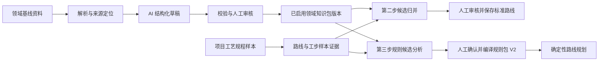

# 领域知识包设计

## 目标

将机械加工领域的术语、本体关系、决策规则和路线模板从分散的代码、提示词及静态文件中逐步抽离，形成可审核、可版本化、可复用的领域知识包。ProcessMind 的项目工作流和规则执行保持通用；新增零件族或领域时，优先通过新增或扩展知识包完成，而不是在业务代码中继续堆叠专用判断。

首个知识包以用户提供的“本体与规则基线”13 份 Markdown 文件为输入，范围限定为机械加工。AI 负责解析和提出结构化草稿，领域人员审核后启用。知识包供第二步路线归并和第三步规则分析使用，最终已审核规则仍通过现有规则包 V2 校验、发布和确定性执行。

## 背景与当前问题

当前项目已经具备五步工艺工作流、第二步归并候选和人工审核、第三步因素与规则分析，以及 V2 规则包的校验与确定性规划。主要通用性问题位于领域知识边界：

- 第二步归并存在按名称和工艺族判断的代码逻辑，并由固定 JSON 规则提供业务配置。
- 路线归一、问题树、因素标签和提示词中都存在领域词汇或场景知识。
- 知识库数据和查询意图主要围绕轴套、衬套等零件。
- 辅助资料目前主要作为项目参考记录保存，尚未成为可管理、可审核、可复用的系统级领域知识资产。
- 如果只把所有资料全文塞进每次大模型请求，知识来源、适用范围、版本和实际影响都难以审核，也容易造成不稳定结果。

## 设计原则

1. **分离通用流程与领域配置。** 上传、提取、审核、版本管理、规则编译与执行属于通用核心；术语、因素、归并知识、规则与路线模板属于领域包。
2. **区分样本事实与领域知识。** 工艺规程样本用于证明历史路线中实际出现的工序；领域包用于解释术语、关系和条件。两类证据在存储、提示词、审核界面和追溯信息中保持可辨识。
3. **先草稿、后启用。** AI 提取内容不得自动成为全局硬规则。草稿需经过结构校验和人工审核，再以不可变版本启用。
4. **规则执行保持确定性。** 大模型可用于抽取、归一候选和解释；发布规则由 V2 条件引擎和路线规划器执行。
5. **每条知识都带适用范围和来源。** 领域包可限定零件族、材料类别、工艺场景或阶段，并保留原文件定位、核验状态和内容哈希。
6. **不要求首期建设完整知识图谱平台。** 首期使用有类型的 JSON/Pydantic 契约、数据库版本记录和按需检索即可；只有真实用例需要时再迁移图存储或向量服务。

## 方案选择

### 方案 A：运行时直接注入原始资料

每次运行第二步或第三步时，把相关 Markdown 全文放入模型上下文。

优点是实现快。缺点是上下文与来源难管理、不同请求结果不易复现、适用范围难约束，也很难清楚展示某条建议实际依据了哪段资料。此方案仅适合作为短期实验，不作为产品架构。

### 方案 B：把全部知识硬编码为程序规则

由开发人员逐条把 13 份资料写入代码和固定配置。

优点是运行行为容易控制。缺点是知识维护仍依赖改代码，添加零件族的成本高，且难以支持来源审核与版本切换。

### 方案 C：审核后启用的版本化领域知识包（推荐）

AI 将资料解析为有类型的知识草稿；人审核并启用版本；第二、三步根据当前路线、候选工序和零件族检索相关知识；相关结论带来源进入审核界面。该方案保留 V2 确定性执行边界，并让系统通过新增知识包扩展领域。

## 架构与数据流

领域基线资料通常由系统维护人员导入并在领域范围内复用；项目工艺规程和项目专属参考资料仍属于项目数据。项目可指定适用的领域包版本。若后续确有项目专属知识覆盖全局知识的需求，应通过明确的项目覆盖层表达，不能静默改写全局包。

### 领域知识包契约

每个不可变版本至少包含：

| 资源 | 用途 | 必要信息 |
| --- | --- | --- |
| `manifest` | 包身份和适用范围 | 稳定 ID、名称、版本、领域、零件族范围、状态、内容哈希 |
| `sources` | 来源追溯 | 原文件名、文件哈希、章节/页码/表格定位、核验状态 |
| `concepts` | 本体概念和词典 | 稳定 ID、名称、类型、定义、别名、适用范围 |
| `relations` | 语义关系 | 关系类型、源/目标概念、条件、来源 |
| `factors` | 可询问和可执行因素 | 稳定 key、类型、单位、取值、别名、验证方式 |
| `rule_candidates` | 领域决策知识 | 条件 AST 草稿、结论、作用目标、范围、置信度、来源、审核状态 |
| `route_templates` | 零件族路线参考 | 适用范围、阶段和工序候选、可选性、来源 |

规则候选采用受控结构表达，不把自然语言原文当作可执行表达式。启用包只包含已审核记录；AI 提取结果和人工修订历史另行保留，以便复核和重建。

## 工作流接入

### 第二步：路线归并

第二步继续以项目工艺规程提取出的操作、工步、样本覆盖率和原文证据为事实基础。领域包提供以下辅助信息：

- 将样本中的名称映射到稳定概念 ID 和别名，避免仅凭字符串判断是否同义。
- 为候选工序对补充加工对象、方法、阶段和上下位语义。
- 生成“直接归并、并入上位工序、保持独立”的理由及相关基线来源。
- 检查建议路线是否与包内已审核的阶段顺序或适用约束冲突。
- 从路线模板提供可选补充建议，但与样本全集分栏呈现；不能伪装成历史样本出现过的工序。

当前归并算法可作为初始候选生成器逐步保留。领域包先用于归一和证据增强，再逐步替换过于依赖固定名称的判断。AI 建议不得绕过第二步现有审核动作；用户拒绝或修改的决定需要保存在路线版本中。

### 第三步：规则分析

第三步继续基于当前项目路线和样本差异判断工序出现边界。领域包可提供候选因素、术语关系、工艺机理与已审核的通用约束。AI 输出的每条规则候选必须说明：

- 目标路线节点或稳定工序 ID；
- 条件结构、因素字段及适用范围；
- 样本证据与领域知识依据的分项引用；
- 置信度、不确定点和可能的反例。

领域知识可以帮助解释或提出条件，但不能单独证明某工序在项目样本中“总是出现”。已确认的候选进入现有规则定稿与 V2 编译、校验、发布流程。

### 第五步：规则执行

第五步仍只读取项目当前已发布的 V2 规则包，不在路线生成请求中实时询问模型。规则包需记录编译时使用的领域包 ID、版本和哈希，生成结果继续记录规则包 ID、版本和哈希。领域包更新不会静默改变已发布路线生成行为；需经重新分析、审核和发布后才生效。

## 上传、解析与审核体验

领域知识导入应是一个明确的维护流程，而非普通项目附件上传：

1. 选择领域包或创建新版本并上传资料。
2. 逐文件显示解析状态、识别章节/表格、失败原因和来源定位质量。
3. AI 输出概念、关系、规则和路线模板的增删改草稿，并报告重复、冲突、无适用范围和疑似过期标准。
4. 审核人可按资源类别接受、修改、拒绝或标记待核实。
5. 通过结构校验后启用不可变版本；后续修改建立新版本。
6. 项目选择领域包版本；每个第二、三步建议显示实际使用到的知识条目及来源。

项目辅助资料仍可上传，但需明确它是样本、背景指导、图纸/标准还是项目专属规则，并分别显示其用途、处理状态和影响的工作流步骤。

## 失效与版本管理

- 上传项目主样本时，按现有生命周期使路线及其下游分析失效。
- 更新全局领域包只将选择该包的项目标记为“领域知识有新版本”；既有审核结果和已发布规则包仍可复现。
- 项目切换领域包版本后，第二步归并建议和第三步候选标记为需重算；人工审核记录保留为历史，不直接删除。
- 领域包内容哈希参与分析快照签名；相同样本和相同领域包版本应得到相同的规则输入上下文。非确定性模型建议需保存原始结构化输出与请求的模型/提示词版本以便审计。
- 参考资料增删只使实际依赖它的产物失效，不应无条件把已发布规则包作废。

## 实施阶段

### 阶段 0：盘点与契约

将 13 份文件逐项映射至上述资源类型，记录数据量、重复项、冲突项、来源完整度和未经核验声明。定义最小 Pydantic/JSON 契约及领域包版本生命周期。此阶段不改变现有生成行为。

### 阶段 1：知识包导入 MVP

实现上传、解析、AI 草稿生成、结构校验、人工审核、启用版本和浏览来源。先支持 Markdown 与现有结构化文件解析；明确不支持的格式和扫描件处理状态。初期不强制引入向量数据库。

### 阶段 2：接入第二步

让第二步归一和归并候选读取选定领域包。提供来源明确的建议理由和可选模板建议；保留用户审核流程。以当前机械加工包进行离线样本回放，比较原结果与新建议。

### 阶段 3：接入第三步与规则包

将领域因素和已审核规则纳入规则分析候选；增加证据分型、来源定位和适用范围验证；接入 V2 编译与发布并保存知识包版本追溯。

### 阶段 4：跨零件族验证

选取至少一个与轴套/衬套不同的零件族，用新领域包验证是否能完成术语扩展、第二步归并和第三步规则分析。只有这一阶段通过，才宣称已实现领域可扩展。

## 验收标准

- 13 份基线可导入并生成带来源定位的结构化草稿；解析失败和低置信度条目明确可见。
- 已启用知识包是不可变版本，能够复现审核时使用的概念、规则、模板与来源哈希。
- 第二步的每条领域知识辅助建议可追溯到具体条目；样本覆盖率和样本原文证据仍可独立查看。
- 路线模板补充项与样本事实分开显示；用户审核前不改变标准化路线。
- 第三步候选规则区分样本证据和领域依据，且适用范围不匹配时不应用。
- 只有用户确认并成功通过 V2 验证、发布的规则影响第五步生成。
- 领域包切换或更新不会静默改变已发布规则包的行为。
- 至少一个新零件族可通过新增知识配置参与第二、三步分析，不需要新增同类领域专用分支代码。

## 非目标

- 首期不建设通用知识图谱数据库、复杂可视化图谱编辑器或外部向量检索服务。
- 不让大模型直接发布生产规则或实时生成无规则包约束的最终路线。
- 不把所有项目参考资料提升为全局知识。
- 不自动认定国家标准当前有效，也不把示例路线视为强制工艺。
- 不在本设计中重写文档抽取、第二步归并算法或 V2 规则引擎；它们通过明确接口逐步接入领域包。

## 风险与处理

- **源资料存在错误、过期或示例内容。** 保留核验状态、适用范围和审核流程；未经核验知识不得变成强约束。
- **名称归一导致错误合并。** 术语映射只生成候选，第二步展示样本内容和差异，用户审核决定最终归并。
- **跨零件族误用。** 领域包、规则和模板都带适用条件；未知或不匹配时不自动应用。
- **AI 把说明性文字误读为命令或规则。** 文件内容仅作为数据解析；结构化结论必须引用原文并经过契约验证。
- **知识包过早承担太多职责。** 首期只覆盖概念、关系、因素、规则候选、路线模板及来源；不引入本体推理语言或全自动知识融合。
